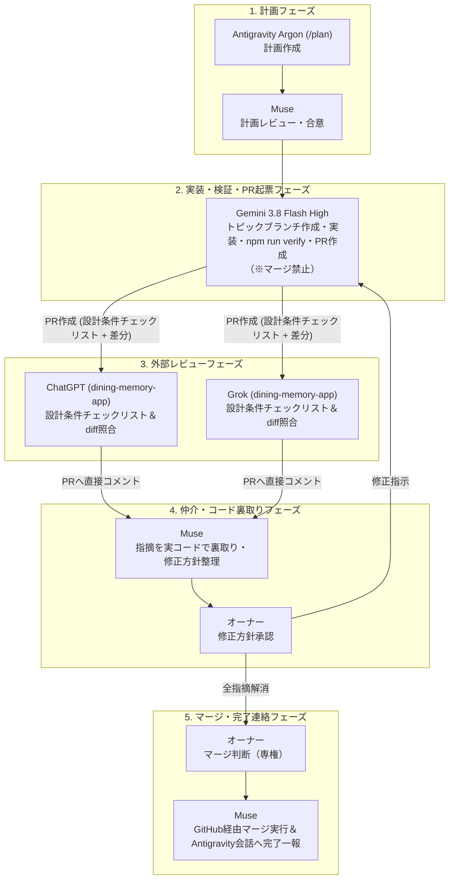

# Development Workflow

## Meta
- Purpose: define how developers and AI agents should work in this repository.
- Audience: developers, AI agents, and code reviewers.
- Update trigger: when the team changes how developers or AI agents should read, edit, or verify work.
- Related docs: [AGENTS.md](../../AGENTS.md), [docs/engineering/context-map.md](context-map.md), [docs/index.md](../index.md), [docs/engineering/coding-standards.md](coding-standards.md)

## Workflow
1. Read `AGENTS.md`.
2. Open `docs/engineering/context-map.md`.
3. Open `docs/index.md` only when you need the broader documentation map.
4. Read the smallest set of docs, source files, and tests needed for the task.
5. Confirm the source of truth for the area you are changing.
6. Inspect the relevant source files before editing.
7. Identify at least one existing implementation pattern to follow when possible.
8. Make the smallest safe change that solves the problem.
9. Update tests and documentation when behavior changes.
10. Verify the result.

## Task Shape
- Prefer bounded tasks with one clear outcome.
- Keep one task focused on one primary purpose.
- If a task spans product, UX, and implementation, resolve the docs first and then edit code.
- Avoid mixing unrelated changes in one pass.
- Separate behavior changes from cleanup-only changes unless combining them clearly reduces risk.

## Issue and Task Tracking Policy
To prevent double-maintenance overhead and synchronization drift between GitHub Issues and the codebase, follow the three-tier tracking model:

1. **Three-Tier Tracking Model**:
   - **Candidate Index ([TASKS.md](../../TASKS.md))**: lightweight index of immediate (`Now`), planned (`Next`), and triggered (`Later`) tasks. Used to prioritize work without reading the entire repository.
   - **Specification & Acceptance Criteria ([docs/issues/](../issues/) and [docs/notes/](../notes/))**: single source of truth for technical specifications, investigation benchmarks, and acceptance criteria. Version-controlled directly alongside source code.
   - **Ticket Lifecycle & Automation (GitHub Issues)**: tracks open/closed lifecycle, assignees, milestones, and pull request linkages.

2. **Thin GitHub Issues**:
   - When opening a GitHub Issue, keep the issue body thin: state the high-level objective and link directly to the corresponding `docs/issues/issue-XX-xxx.md` file.
   - Do not copy-paste detailed acceptance checklists into GitHub Issues to avoid synchronization drift.

3. **PR Linkage & Auto-Close (`Closes` vs. `Refs`)**:
   - **Full Resolution PRs**: When a PR completely resolves an issue, declare `Closes #<issue-number>` (or `Fixes #<issue-number>`) so merging automatically closes the GitHub Issue.
   - **Investigation & Multi-Phase PRs**: When a PR covers an investigation spike, a partial milestone, or a parent issue that spawns child implementation issues (e.g., investigation Issue #75 spawning implementation Issues #86, #87, #88), use `Refs #<issue-number>` or `Relates to #<issue-number>` instead. Do **not** use `Closes` unless the issue is explicitly intended to close upon merge.

4. **Synchronous Ledger Updates**:
   - In the same PR that implements or completes the task, update:
     - [TASKS.md](../../TASKS.md): move the task from `Now` to `Done / Historical Notes`.
     - `docs/issues/issue-XX.md`: update status to closed, mark acceptance checkboxes `[x]`, and record the PR number.

5. **Future-Triggered Tasks (`Later`)**:
   - Tasks awaiting future trigger conditions (e.g., Issue #80 Keyset pagination or Issue #81 composite index awaiting 10,000 records) remain classified as `Later / Future-triggered`.
   - On GitHub, tag these issues with `later` or `future-triggered` to keep the active backlog clean.

6. **ID Distinction Rule (Internal Doc ID vs. GitHub Issue Number)**:
   - The sequence number in `docs/issues/issue-XX-*.md` (`XX`) is an internal repository document ID, **not** the GitHub Issue number.
   - For example, `issue-01` maps to GitHub Issue #73, and `issue-12` is an internal document ID where the corresponding GitHub Issue is not yet filed (unrelated to GitHub PR/Issue #12).
   - In all `docs/issues/` headers, explicitly specify both `- **内部ドキュメントID**: issue-XX` and `- **対応 GitHub Issue**: GitHub Issue #YY` (or `未起票`).
   - Always refer to GitHub Issues with the full prefix `GitHub Issue #YY` to prevent AI agents and contributors from conflating internal doc numbers with GitHub issue numbers.

7. **PR Close Comment Standard（PR クローズコメント標準 — 再開条件と根拠ドキュメントリンクの必須化）**:
   - PR をマージせずクローズ（Reject / Close without merge）する際は、単に理由を述べるだけでなく、以下の3要素をコメントに必須で記載する：
     1. **クローズ理由の要約 (Objective Reason)**:
        - 技術的根拠、安全性の懸念、設計意図（fail-fast / sequential 等）への抵触、既存 PR との重複、または必須 Evidence（実測値・テスト）の不足など、客観的な事実に基づいた理由。
     2. **再開・再提案の受け入れ条件 (Reopening Criteria Checklist)**:
        - 将来どのような実測ベンチマーク、障害系・エッジケーステスト、またはアーキテクチャ合意が得られれば再開できるかをチェックリスト（`- [ ]`）形式で明文化する。
     3. **根拠ドキュメント・関連リンク (Evidence Links)**:
        - 関連する内部 Issue Doc（`docs/issues/issue-XX.md`）、実測ノート（`docs/notes/*.md`）、関連 Issue / PR へのハイパーリンクを必ず記載する。
   - これにより、再開条件が曖昧なまま不完全な PR が再提案されるループを防止し、後続のエージェントや開発者が判断根拠を即座に辿れるようにする（例: PR #220 のクローズコメントおよび [docs/issues/issue-14-backup-restore-concurrency-criteria.md](../issues/issue-14-backup-restore-concurrency-criteria.md)）。

## Multi-Agent Roles & End-to-End Workflow (多エージェント開発ワークフローと役割分担)
本リポジトリでは、自律的かつ安全に高品質な開発を推進するため、以下の5つの役割分担・責任境界に基づいてエンドツーエンドで開発を回します。



### 1. 計画フェーズ (Planning)
- **担当**: Antigravity の **Argon**（`/plan`）が作成し、**Muse** がレビューする。
- **責務**:
  - 現状の課題と客観的事実の調査。
  - 設計条件チェックリスト（Design Criteria Checklist）、スコープ境界、検証方針の策定。
  - 変更対象ファイルと具体的な変更方針の明確化。
  - 計画合意後、実装フェーズへハンドオフする。

### 2. 実装フェーズ (Implementation)
- **担当**: **Gemini 3.8 Flash High**
- **責務**:
  - トピックブランチ（`feat/*`, `fix/*`, `docs/*` 等）の作成。
  - 計画で合意された設計条件に従ったコード・ドキュメントの実装。
  - PR 作成前のローカル標準検証（**`npm run verify`**）の実行と exit 0 の確認（ネイティブ変更時は加えて `npm run build:android:debug`）。
  - 後述の規約に従い、必須 4 セクションと設計条件チェックリストを含む PR の作成。
- **責任境界（厳守）**:
  - **実装担当はマージを行わない（マージ禁止）**。PR の作成までを担当し、マージ操作は一切行わない。

### 3. レビューフェーズ (Review)
- **担当**: **ChatGPT** および **Grok**
- **レビューの場**:
  - ChatGPT プロジェクト: **`dining-memory-app`**
  - Grok プロジェクト: **`dining-memory-app`**
- **責務**:
  - PR 本文に記載された「設計条件チェックリスト」とコード差分（diff）を 1 項目ずつ照合。
  - 要件漏れ、境界値の不備、既存規約（機械的ゲート、型安全性、プライバシー等）との整合性を検証。
  - レビュー結果および指摘事項を GitHub PR へ直接コメントとして投稿する。

### 4. 仲介・検証フェーズ (Mediation & Verification)
- **担当**: **Muse**
- **責務**:
  - ChatGPT および Grok から PR に投稿された各指摘事項について、実際のコードベースおよびテストと照合して裏取り（事実確認・妥当性検証）を行う。
  - 修正が必要な論点・対応方針を整理し、**オーナーの承認**を得る。
  - オーナー承認を得た修正方針を実装担当（Gemini 3.8 Flash High）へ伝達し、修正と再検証（`npm run verify`）を指示する。

### 5. マージフェーズ (Merge)
- **マージ判断（厳守）**: **マージ判断はオーナーのみが行う（オーナー専権）**。AI エージェントが自律的にマージ判断を下すことは禁止。
- **実行担当**: **Muse**
- **責務**:
  - オーナーによるマージ承認を受けた後、Muse が GitHub 経由で PR をマージする。
  - マージ完了後、Muse は当該機能・タスクを扱っている Antigravity 会話へ完了を一報する。

## Before Editing
- Identify the canonical doc and the implementation files that are the source of truth.
- Prefer `src/` and current canonical docs over deprecated docs and historical notes.
- Read the nearest existing pattern before adding a new abstraction, helper, or file shape.
- Reuse an established pattern unless there is a clear reason not to.

## Editing Rules
- Preserve user changes.
- Do not rewrite unrelated files.
- Keep diffs local to the behavior being changed.
- If a doc is now stale, update the canonical doc instead of adding a second copy elsewhere.

## Core Governance Principles
- **自然言語の禁止リスト依存からの脱却**: 言い訳で容易にすり抜けられる細かな禁止構文の列挙でエージェントを縛るアプローチを廃止し、機械判定と客観的証拠にオフロードする（詳細は [.jules/rules.md](../../.jules/rules.md) 参照）。
- **機械的判定への完全オフロード (No machine gate, no trust)**: 差分ゼロ、テスト削除・弱体化、および PR 本文の Evidence 欠落は `scripts/verify-pr-gates.sh` で、新規 `any` やエスケープハッチ（`@ts-ignore` 等）は ESLint で物理的に遮断する。
- **客観的証拠の義務化 (No evidence, no PR)**: 具体的課題と客観的証拠（失敗テスト、実測値、EXPLAIN 結果等）が示されない PR は起票しない。
- **「変更しないこと」の成功定義 (No actionable finding, stop)**: 調査の結果、対処すべき問題がなければ無理にコード変更を捏造せず、レポートを残して「変更なし」で終了することを成功とする。
- **ブランチ保護と直接プッシュ禁止の機械的強制**: main ブランチへの直接コミットおよび force-push は GitHub Ruleset（ID 19937013）によって例外なく（Bypass 不可）物理的にブロックされている。ドキュメント単独更新を含むすべての変更はトピックブランチから PR を作成し、必須ステータスチェックを通過させてマージする（詳細は [docs/notes/git-branching-and-ci-governance.md](../notes/git-branching-and-ci-governance.md) 参照）。

## PR Eligibility Criteria & PR Description Rules
詳細は [.jules/rules.md](../../.jules/rules.md) を参照してください。
- **Problem**: 現行コードベースにおける具体的な事実（破損、脆弱性、測定されたボトルネック、明示された要件）。
- **Evidence**: 客観的証拠（失敗テストログ、実測ベンチマーク、EXPLAIN 結果等）。
- **Scope**: 課題解決に直結する最小限の変更（スコープ外の周辺コードを触らない）。

### PR 本文の標準構成（必須4セクション＋設計条件チェックリスト）
PR を起票する際は、CI の Evidence Gate（`verify:pr-gates`）で検査される以下の必須 4 セクションを必ず含め、さらに外部レビュー（ChatGPT / Grok）との照合基準となる **「設計条件チェックリスト (Design Criteria Checklist)」** を明記します。

```markdown
### 具体的な問題 (Problem)
現行コードベースにおける具体的な事実、不具合、測定されたボトルネック、または要求仕様。

### 客観的証拠 (Evidence)
客観的証拠（失敗テストログ、実測値、プロファイル結果、または仕様/Issue/受入基準の参照）。
※空欄や「TODO」「なし」等のプレースホルダーは不可。

### 期待される効果 (Expected Impact)
変更によって得られる具体的な成果や改善点。

### 意図して変更しなかったこと (Out of Scope)
意図的に今回の変更に含めなかった関連領域、不要なリファクタリングの排除。

### 設計条件チェックリスト (Design Criteria Checklist)
- [ ] 条件1: 計画で合意された仕様・境界条件
- [ ] 条件2: レビュアー（ChatGPT/Grok）が差分と照合して確認すべき具体項目
- [ ] 条件3: ガバナンス・テスト・ドキュメント整合性
```

## Verification Rules
- **2段階検証運用 (Two-Phase Verification)**:
  1. **対話的な実装・動作確認時 (Quick Loop — Default)**:
     - ユーザーからの機能変更・UI修正指示に対しては、コード変更後に直結する単一テスト（`npx jest <target.test.ts>`）および型検査（`npm run type-check` または補助検証 `npm run verify:quick`）を確認し、即座に完了報告する。
     - コード変更時は `verify:quick`（`--onlyChanged`）で対象テストが 0 件だった場合を含め、必ず該当の単一テストを明示指定して実行するか、該当テストが存在しない理由を報告する。
     - 動作確認前の段階で、全件テスト（`npm test` / `test:python:fast`）や台帳同期を毎回回してユーザーを待たせない。
  2. **コミット・PR作成時 (Commit / PR Gate)**:
     - ユーザーが手元で動作を確認し、コミットや PR 作成へ進む段階で、**本リポジトリの標準検証コマンド `npm run verify`（フルゲート）** を実行し、全チェックが PASS（exit 0）することを確認する。
     - ネイティブ変更や Expo SDK 変更時は加えて `npm run build:android:debug` を実行する。
     - 同時に対応する `TASKS.md` や `docs/issues/` の台帳更新を実施する。
- Run the most relevant checks for the change.
- For behavior changes, verify the affected path with tests.
- For type or interface changes, run type checking or the narrowest equivalent validation.
- For docs-only changes, confirm links and structure are correct (`npm run check:docs`).

## Review Gate
- **PR 作成時の標準検証コマンド (Standard PR Gate)**: **`npm run verify`**
  - PR 作成前に手元で必ず実行し、以下の全 10 ゲートが exit 0 でパスすることを確認する:
    1. `npm run verify:pr-gates`（Machine gate: 差分ゼロ、eslint-disable、テスト削除・弱体化、.jules/ 保護、PR 本文 Evidence Gate）
    2. `npm run check:react-versions`（React / React Native バージョン整合性）
    3. `npm run check:deps`（Knip による依存関係チェック）
    4. `npm run check:docs`（ドキュメント整合性・リンク切れチェック）
    5. `npm run format:check`（Prettier フォーマットチェック）
    6. `npm run lint`（ESLint 静的解析・型安全性）
    7. `npm run type-check`（TypeScript 型チェック）
    8. `npm run check:expo-doctor`（Expo プロジェクト健全性）
    9. `npm test`（Jest フルテストスイート）
    10. `npm run test:python:fast`（Python 単体テスト）
- Test-only PR gate: PRs that add or update tests must pass the full test suite (`npm test`) across the entire repository. Running only the single targeted test file (e.g. `npx jest tests/myTest.test.ts`) is strictly insufficient to prevent Jest global mock collisions and cross-suite regressions.
- Machine gate for PRs: `npm run verify:pr-gates` (`bash scripts/verify-pr-gates.sh`). Automatically enforced in CI for pull requests (zero diff check, test protection, and PR body Evidence Gate).
- The same standard gate should stay mirrored in GitHub Actions CI for `main` pushes and pull requests.
- Add `npm run check:deps` and `npm run check:react-versions` when dependencies are added, removed, or reorganized. Follow [docs/engineering/dependency-policy.md](dependency-policy.md).
- If native dependencies (Tier 1) or Expo SDK change, run `npm run build:android:debug` locally (Jest tests pass via mocks and do not guarantee native compatibility). In CI, the `native-build` job automatically runs `build:android:debug` when native-sensitive files change.
- If `package.json`, `package-lock.json`, or `.github/workflows/ci.yml` changes, run `npm ci` before finishing the task.
- If dependency install only passes on a different Node/npm version than CI, update the CI runtime and the setup docs in the same task or regenerate the lockfile for the existing CI version.
- Use the narrowest useful verification first, but do not skip the standard gate for meaningful behavior changes.
- Add a security review pass when changes touch permissions, file storage, location, export, backup, or external AI calls.
- Run `npm run check:docs` when a task changes AI input assist, MediaPipe labeling, Records, Search, Stats, Settings, storage, runtime assumptions, or documentation about current behavior.

## Test Quality and Mock Isolation Standard
テスト追加・修正 PR における品質維持およびモック干渉防止のための必須基準です（GitHub Issue #233）。

1. **フルテストスイート（`npm test`）実行の義務化**:
   - テスト専用 PR（`tests/` 配下のみの変更、またはテストコードの追加・修正）であっても、マージ前に必ずリポジトリ全体のフルスイート（`npm test` / CI では `test:coverage`）を実行しパスさせる。
   - 単一テストファイルの実行（例: `npx jest tests/myTest.test.ts`）のみで完了とみなすことは禁止。
   - 他のテストファイル（特に共通ネイティブモジュールや Expo API をモックしているスイート）との干渉やリグレッションがないことを機械的に検証する。

2. **モック干渉（Mock Collision）防止とグローバル環境保護**:
   - **共通モックの集約**: プロジェクト全体で頻繁にモックされる Expo / React Native ネイティブモジュール（例: `expo-image-picker`, `expo-media-library` など）は、個別テストファイル内で多重に `jest.mock()` 定義せず、`jest.setup.js` に共通モックとして集約する。
   - **スコープ内制御の徹底**: 個別テストで特定の戻り値や例外をテストする場合は、モック全体の再定義を避け、`jest.mocked(...).mockResolvedValueOnce(...)` や `mockReturnValueOnce(...)` を使用する。
   - **クリーンアップ**: 各テストスイートでモック呼び出し履歴や一時的な振る舞いが残留しないよう、`beforeEach(() => { jest.clearAllMocks(); })` などを適切に配置する。

3. **アサーション品質の維持 (No Shallow Assertions)**:
   - 単なる「要素が存在すること」「関数が呼ばれたこと」だけの形式的・表層的なアサーション（Shallow assertion）を量産しない。
   - 不具合や仕様逸脱が発生した際に、どの境界値やビジネスロジックが壊れたかを客観的に特定できるよう、期待される入出力、エラー分岐、状態変化を明示的に検証するアサーションを義務付ける。

## Doc Sync Gate
- Before editing, identify the source area and the canonical docs that describe it.
- After editing source, check the matching canonical docs even if the task did not explicitly ask for docs.
- If source changed but docs did not, state why the current docs still match.
- If docs changed but source did not, verify the docs describe current behavior and not a planned or historical behavior.
- Use [docs/engineering/context-map.md](context-map.md) to choose the smallest doc set to check.
- Refer to `Doc Sync Targets` in [docs/engineering/context-map.md](context-map.md) for the exact mapping between source areas and canonical docs.
- Treat `docs/deprecated/` and `docs/working/` as history; do not use them as proof of current behavior.
- Keep historical notes explicit when they mention old behavior.
- For current-behavior drift phrases, run `npm run check:docs` and review any matches before finishing.

## When to Run What
- Docs-only changes: verify links, filenames, and document consistency.
- Type or interface changes: run `npm run type-check`.
- Behavior changes: run `npm test`, and run `npm run lint` if touched files include application code.
- Test-only changes (`tests/` additions or updates): run full `npm test` across the entire repository (never stop at single-file validation) to guard against Jest global mock collisions and verify cross-suite isolation, plus `npm run type-check`.
- Dependency changes: run `npm run check:deps`, `npm run check:react-versions`, and follow [docs/engineering/dependency-policy.md](dependency-policy.md). If native modules (Tier 1) change, also run `npm run build:android:debug`.
- Dependency or CI runtime changes: run `npm ci` and confirm `README.md` and `.github/workflows/ci.yml` still describe the same runtime expectation.
- Permission, export, backup, location, file, or external-send changes: confirm what data is accessed, stored, logged, or sent.

## AI-specific Risks
- Hallucinated APIs or unsupported library behavior.
- Code that technically runs but does not match the intended behavior.
- Duplicate helpers, dead abstractions, or unused branches left by generated code.
- Missing regression coverage or tests that were weakened to avoid failures.
- Security, maintenance, or license issues introduced through new dependencies.
- False confidence from automated review without human inspection.

## Security-specific Risks
- Secrets committed to code, examples, or debug output.
- Personal data exposed through logs, alerts, exports, or notes.
- Permissions requested earlier or more broadly than the feature requires.
- External transmission introduced without a clear user-facing explanation.
- Backup or export flows exposing more data than the user expects.

## Documentation Update Rules
- Keep `README.md` as an onboarding entry point; move detailed operational rules to the matching canonical document and link to it.
- Mark historical plans or improvement notes as stale, done, or obsolete when implementation catches up so they are not mistaken for current rules.
- If product scope changes, update `docs/product/overview.md`.
- If a screen or interaction changes, update `docs/ux/*`.
- If schema or storage changes, update `docs/domain/database-design.md`.
- If coding conventions change, update `docs/engineering/coding-standards.md`.
- If the development workflow changes, update this file and `AGENTS.md`.
- If a change affects permissions, local storage, export, backup, or external data transfer, update `docs/architecture/tech-spec.md`.
- If a change touches photo paths, location, notes, raw AI output, export, or sharing, verify production-like logs do not expose sensitive user data.

## Definition of Done
- Summarize what changed.
- List the files touched.
- State what was verified.
- Call out any risks or follow-up work that remains.
- Make any unverified assumptions explicit.

## Good Defaults
- Keep prompts and task descriptions specific.
- Prefer existing patterns in the repo.
- Treat the canonical docs as the source of truth.
- Verify AI-generated code before trusting it.
- Use human review to supplement automated review and test output.
