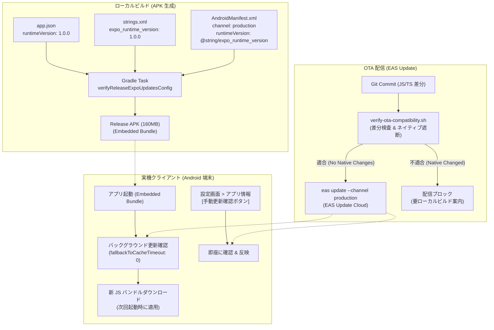

# EAS Update (expo-updates) 運用ガイドライン

## 1. 目的と基本原則

本ドキュメントは、`dining-memory-app` における EAS Update（`expo-updates`）を用いた OTA（Over-The-Air）アップデートの運用基準、公開手順、ロールバック手順、およびネイティブ互換性の境界を定めた運用ガイドラインです。

### 基本方針
1. **無料プラン（Free Plan）の範囲内での完結**:
   - EAS Update の無料枠（1,000 MAU / 月）内で運用します。有料プランへの加入やクレジットカード登録は行いません。
   - 頻繁な日常リリースではなく、「軽微な JS の不具合修正」「文言や UI の緊急修正」に限定して利用します。
2. **ローカルビルド体制の維持 (EAS Build 非利用)**:
   - APK のビルドは従来どおりローカル環境（`npm run release:android` / Gradle）で行います。EAS Build は導入しません。
3. **ネイティブ互換性の物理的保護 (Strict Compatibility Boundary)**:
   - ネイティブ変更を伴う更新を OTA で配信することは事故・クラッシュの最大原因となります。
   - `runtimeVersion`（例: `"1.0.0"`）の一致検証、および `scripts/verify-ota-compatibility.sh` による配信前検査を義務付けます。

---

## 2. OTA 配信可否の線引き基準 (Compatibility Boundary)

EAS Update は JavaScript / TypeScript コードおよび Metro がバンドルする静的アセットのみを更新できます。ネイティブバイナリ（Java / Kotlin / C++ / AndroidManifest / ProGuard）やネイティブリンク依存の更新はできません。

| 変更対象 | OTA 配信の可否 | 必要な対応 |
| :--- | :---: | :--- |
| **画面コンポーネント・UI 調整** (`src/screens/*`, `src/components/*`) | ✅ **可** | `npm run update:publish` |
| **ビジネスロジック・バグ修正** (`src/database/*`, `src/utils/*`) | ✅ **可** | `npm run update:publish` |
| **文言・UI テーマ・スタイル修正** (`src/theme/*`) | ✅ **可** | `npm run update:publish` |
| **純粋 JS ライブラリの追加・更新** (`piexifjs` など) | ✅ **可** | `npm run update:publish` |
| **ネイティブ依存の追加・変更** (`expo-*`, `react-native-*`, `llama.rn`) | ❌ **不可** | `runtimeVersion` をバンプし、APK ローカル再ビルド |
| **Android 設定変更** (`android/*`, `AndroidManifest.xml`, `build.gradle`) | ❌ **不可** | `runtimeVersion` をバンプし、APK ローカル再ビルド |
| **Expo SDK バージョンアップ** | ❌ **不可** | `runtimeVersion` をバンプし、APK ローカル再ビルド |
| **ビルド設定・ネイティブ構成** (`app.json`, `app.config.js`, `babel.config.js`, `metro.config.js`, `eas.json`) | ❌ **不可** | `runtimeVersion` をバンプし、APK ローカル再ビルド |
| **AI モデルファイル更新** (`assets/mediapipe/*.task`) | ❌ **不可** | APK 同梱アセットまたはリモートモデル配布パイプライン |

> [!WARNING]
> ネイティブコードやネイティブライブラリの変更を含むコミットに対して OTA 更新を公開した場合、端末側の古いネイティブ実装と新しい JS コードが衝突してアプリがクラッシュします。必ず事前に `npm run update:check` を実行してください。

---

## 3. 安全機構のアーキテクチャ (Safety Architecture)



### 1. `runtimeVersion` の同期保証
Bare Workflow の Android アプリでは、ネイティブ側の Java コードが `AndroidManifest.xml` および `strings.xml` から `runtimeVersion` を読み取ります。
- `app.json` の `expo.runtimeVersion`
- `android/app/src/main/res/values/strings.xml` の `expo_runtime_version`
この2つが1文字でも異なると、配信された OTA 更新が端末でマッチせず破棄されます。
本プロジェクトでは Gradle ビルドタスク（`verifyReleaseExpoUpdatesConfig`）および `scripts/build-android-release.sh` により、不一致がある場合はビルド自体を機械的にブロックします。

### 2. チャンネルと Bare Workflow 設定
- EAS Build を介さないローカルビルドでは、`AndroidManifest.xml` に以下の meta-data を明示設定しています：
  - `expo.modules.updates.ENABLED`: `true`
  - `expo.modules.updates.EXPO_UPDATE_URL`: `https://u.expo.dev/c2f7dc2a-6098-44ba-b2c5-7f9cb65d3d41`
  - `expo.modules.updates.EXPO_RUNTIME_VERSION`: `@string/expo_runtime_version`
  - `expo.modules.updates.UPDATES_CONFIGURATION_REQUEST_HEADERS_KEY`: `{"expo-channel-name":"production"}`
- `fallbackToCacheTimeout: 0`（app.json）: アプリ起動時のネットワーク待機によるブラックアウトや遅延を防ぎ、内蔵バンドルですぐに画面を表示した上でバックグラウンドで新バンドルをフェッチします。

---

## 4. 運用 Runbook

### A. 公開前チェック（事前検証）
JS 修正のコミット後、配信して安全かどうかをローカルで検査します。

```bash
# 1. リポジトリの標準検証を通過していることを確認
npm run verify:quick

# 2. OTA 互換性チェックを実行
npm run update:check
```

`update:check` は以下の項目を検証します：
1. 作業ツリーに未コミットの変更がないこと（コミット必須）。
2. `app.json` と `strings.xml` の `runtimeVersion` が完全一致していること。
3. 基準コミット（`origin/main` または指定ベース）との差分に、`android/`、`package-lock.json`、ネイティブ依存パッケージが含まれていないこと。

### B. OTA アップデートの公開
検査を通過したら、production チャンネルへ更新を配信します。

```bash
# メッセージを添えて公開
npm run update:publish -- --message "Fix: 食事詳細画面のメモ下書きプレビュー表示不具合"
```

> [!NOTE]
> 初回実行時に `eas-cli` の Expo アカウントログインが求められる場合があります。

### C. 実機での確認
1. **自動適用**: アプリを起動するとバックグラウンドで更新がダウンロードされ、次回のアプリ再起動時に適用されます。
2. **手動適用**: アプリの「設定」画面 ＞「アプリ情報」セクションにある **「アプリの更新を確認」** ボタンをタップすると、即座に更新の有無を確認・適用できます。更新が適用されると、Update 行の表示が `Embedded (ビルド同梱)` から `OTA (<update-id 先頭8文字>)` に変化します。

### D. 緊急ロールバック手順
万が一、配信した OTA アップデートに不具合が見つかった場合の対処法です。

#### 方法 1: 正常な過去コミットからの再配信（推奨）
Git 上で問題のない直前のコミットに戻り、その状態から OTA アップデートを上書き配信します。
```bash
git checkout <good-commit-hash>
npm run update:check -- --allow-dirty
npx eas update --channel production --message "Rollback: revert to <good-commit-hash>"
git checkout main
```

#### 方法 2: EAS CLI の `re-publish` を利用
過去に公開された正常な Update ID を特定し、それを再度アクティブにします。
```bash
# 過去のアップデート一覧を確認
npx eas update:list

# 正常だった Update ID を再公開
npx eas update:re-publish --group <good-group-id>
```

---

## 5. Free Plan（無料枠）運用ルール

EAS Update の Free Plan は **月間 1,000 MAU** の配信枠が提供されています。
本アプリは個人開発および限られたユーザー向けのテスト運用であるため、通常運用では 1,000 MAU を超過することはありませんが、以下の運用原則を遵守してください：

1. **不用意な連続配信の防止**:
   - 1行の微修正ごとに何度も `update:publish` を叩かないこと。
   - PR がマージされ、検証が完了した単位でまとめて配信すること。
2. **チャンネルの乱立防止**:
   - 原則として `production` チャンネルのみを使用します。
   - 開発時のホットリロードは Expo Go / Metro Dev Server（ローカル）で行い、EAS Update を開発中のプレビュー用途で常用しないこと。
