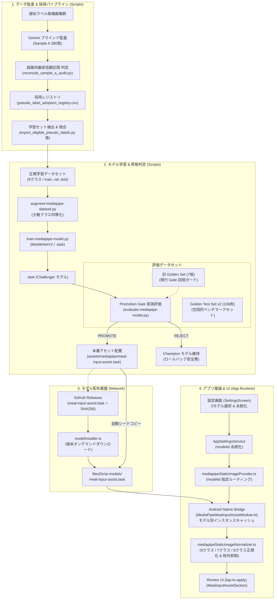

# MediaPipe 食事分類システム 総合概要 (MediaPipe System Overview)

## Meta
- Purpose: MediaPipe 食事分類機能の全体アーキテクチャ、正本リンク、コンポーネント構成、開発者 Runbook を集約し、人間と AI エージェントの認知負荷・コンテキスト消費を低減する総合案内所。
- Audience: アプリ開発者、ML/パイプライン保守者、AI エージェント。
- Update trigger: パイプライン構成、正本パス、運用フロー、主要ステータスが更新されたとき。
- Related docs: [docs/engineering/context-map.md](context-map.md), [docs/index.md](../index.md), [docs/architecture/tech-spec.md](../architecture/tech-spec.md), [docs/architecture/food-labeling-pipeline.md](../architecture/food-labeling-pipeline.md), [docs/engineering/golden-test-set-v2-specification.md](golden-test-set-v2-specification.md), [scripts/README.md](../../scripts/README.md)

---

## 1. システム全体アーキテクチャ (Architecture Diagram)

MediaPipe 食事分類機能は、オフラインのデータ監査・学習パイプラインから、端末内の Native 推論および React Native UI に至るまで、以下の 4 つのレイヤーで構成されています。



---

## 2. 情報の正本管理 (Single Source of Truth)

数値の陳腐化や文書間の不整合を防ぐため、ハッシュ値、件数、個別設定の**正本（Single Source of Truth）は以下の各ファイルに一元化**されています。具体的な値は各正本ファイルを参照してください。

| 情報項目 | 正本ファイル / エビデンス | 概要 |
|---|---|---|
| **Champion モデルバイナリ** | `android/app/src/main/assets/mediapipe/meal-input-assist.task`<br>[docs/issues/issue-22-integrate-agreed-pending-and-promote-challenger.md](../issues/issue-22-integrate-agreed-pending-and-promote-challenger.md) | Promotion Gate を突破し本番アセットへ昇格された最新モデルバイナリとハッシュ記録。 |
| **マルチモデル仕様・定義** | `src/ai/mealInputAssist/modelConfig.ts`<br>`android/app/src/main/java/com/tahosook/diningmemory/MediaPipeMealInputAssistSupport.kt`<br>[docs/issues/issue-23-dual-dining-classification-models.md](../issues/issue-23-dual-dining-classification-models.md) | 3モデル（調理法9クラス、汎用シーン7クラス、わたし専用8クラス）のID、ラベル、説明、SHA-256、アセット名。 |
| **Golden Test Set v2** | `docs/engineering/golden-test-set-v2-specification.md`<br>`state/mediapipe-dataset/golden_eval_v2/manifest.jsonl` | 106枚・9クラスの包括的ベンチマークデータセット仕様およびマニフェスト。 |
| **現行 Promotion Gate 回帰ガード (旧Golden 7枚)** | `state/mediapipe-dataset/golden_eval/test/`<br>`scripts/run-autonomous-model-improvement.sh` | 自律改善ループで回帰防止ガードとして参照される少数固定データセット（N=7）。 |
| **データセット外部保管 & 復元手順** | [docs/engineering/mediapipe-dataset-recovery.md](mediapipe-dataset-recovery.md) | `.gitignore` 対象の実画像データセット構成、外部保管方針、復元手順 Runbook。 |
| **疑似ラベル採用レジストリ** | `state/mediapipe_labeling_runs/zip2-audit-manifest-20261009/pseudo_label_adoption_registry.csv`<br>[docs/issues/issue-19-mediapipe-audit-sample-a-reconciliation.md](../issues/issue-19-mediapipe-audit-sample-a-reconciliation.md) | Sample A ブラインド監査突合結果に基づく候補母集団全831枚の個別ステータス。 |
| **アプリランタイム設定** | `src/ai/mealInputAssist/environment.ts`<br>`src/ai/mealInputAssist/modelConfig.ts` | アプリ側のデフォルトランタイムモードおよびモデル配布設定。 |

---

## 3. コンポーネントの役割とステータス区分

各コンポーネントの現状を **「確認済み（Verified）」「未確認（Unverified）」「今後の判断事項（TBD）」** に区分して示します。

### 3.1 アプリ推論 & UI (Runtime)
- **ステータス**: **確認済み**
- **役割**: Android Native Bridge（MediaPipe Tasks Vision）を介してローカルの `.task` ファイルから推論を実行し、TS 層で料理名・ジャンルに正規化して Review 画面に tap-to-apply 提示する。設定画面（`SettingsScreen`）から分類モデル（3種類）の切り替えに対応。
- **確認済み事実**:
  - `MediaPipeMealInputAssistModule.kt` は `filesDir/ai-models/` にモデルがない場合、同梱アセット（`assets/mediapipe/`）から自動シードコピーして `MappedByteBuffer` で安全にロードする仕組みを保持。
  - `MediaPipeMealInputAssistSupport.kt` およびモジュール本体にて、選択されたモデルID（`cooking_method_9class`、`universal_scene_7class`、`personal_household_8class`）ごとに `ImageClassifier` インスタンスをキャッシュ管理し、モデル切替時もメモリ効率と高速推論を両立。
  - `main` ブランチ上の既定ランタイムは `mediapipe-static-image`、既定モデルは `cooking_method_9class` に設定済み。
  - `src/ai/mealInputAssist/mediapipeStaticImageNormalizer.ts` は以下の3体系の正規化マッピングを配備：
    1. **調理法9クラス**（`curry_rice`, `drink`, `fish_dish`, `fried_dish`, `meat_dish`, `noodles`, `simmered_dish`, `stir_fry`, `other_or_exclude`）
    2. **汎用シーン7クラス**（`home_teishoku_set`, `one_plate_or_curry`, `izakaya_bistro_or_party`, `noodles_or_single_bowl`, `dining_out_or_tray_meal`, `drink_or_bottle_record`, `non_food_or_exclude`）
    3. **わたし専用8クラス**（`wife_multi_dish_teishoku`, `wife_nordic_one_plate`, `wife_curry_or_ethnic_plate`, `wife_morning_salmon_natto`, `wife_bistro_baguette_bal`, `wife_izakaya_small_dishes`, `household_pot_noodles_or_ramen_rice`, `special_takeout_party_feast`）
  - 除外対象クラス（`other_or_exclude`、`non_food_or_exclude`）は `excludeFromSuggestions: true` により、UI サジェスト候補（`mealNames` / `cuisineTypes`）から明示的に除外（非表示）され、モデルの推論確信度・メタデータのみに記録される。

### 3.2 モデル配布 & アセット取得基盤 (Distribution & Acquisition)
- **ステータス**: **確認済み**
- **役割**: `scripts/ensure-mediapipe-model.sh` により、GitHub Releases (`mediapipe-model-v0.1.0`) から `.task` ファイルを取得・SHA-256 検証して同梱アセットに配置するとともに、ローカル学習済みの追加モデル（`universal_scene_7class.task`, `personal_household_8class.task`）を自動検証・同期する。また、アプリ側のオンデマンドダウンロード設定（`src/ai/mealInputAssist/modelConfig.ts`）とも整合している。

### 3.3 モデル学習 & 二段階昇格判定 (Training & Two-Tier Gate)
- **ステータス**: **確認済み**
- **役割**: `scripts/train-mediapipe-model.py` で MobileNetV2 を学習し、`scripts/run-autonomous-model-improvement.sh` で Golden Test Set との回帰比較を行い、全ゲートを通過した場合のみ本番アセットへアトミック昇格する。
- **確認済み事実**:
  - **二段階昇格判定（Two-Tier Gate）** が配備済み：
    - **Tier 1 (回帰ガード)**: 旧 Golden 7枚による重要基本サンプルの回帰ゼロ・少数クラス被覆率検証。
    - **Tier 2 (包括的ベンチマーク)**: Golden Test Set v2（106枚）が存在する場合に実測推論を実行し、Challenger が Champion に対する全体精度・Top-3 被覆率を維持しているか検証（未配置環境では安全にスキップ）。
  - Issue 22 にて、合意保留サンプルを統合した Challenger モデルが昇格ゲートを突破し、本番アセットへ昇格完了。

### 3.4 包括的ベンチマーク (Golden Test Set v2)
- **ステータス**: **確認済み (データ整合性 & Tier 2 Gate 連携)**
- **役割**: 旧 Golden 7枚の解像度不足を補うため、学習セットと完全分離された 106枚・9クラスの評価用ベンチマークセット（[docs/engineering/golden-test-set-v2-specification.md](golden-test-set-v2-specification.md)）。
- **確認済み事実**:
  - `scripts/verify-golden-dataset-v2.py` による整合性検証（106件の SHA-256 一致、9クラス整合性、学習セット漏洩ゼロ）に全件パス済み。
  - `scripts/run-autonomous-model-improvement.sh` にて `--evaluate-golden-v2` による自動比較および Tier 2 評価に対応。

### 3.5 データ監査 & 採用レジストリ (Audit & Registry)
- **ステータス**: **確認済み**
- **役割**: 疑似ラベル候補（831枚）に対する確認バイアスを排除した Gemini ブラインド視覚監査（Sample A 280枚）を実施し、超幾何厳密信頼区間により安全なクラス（カレー・ドリンク）のみを採用レジストリとして固定（[docs/engineering/mediapipe-gemini-audit-spec.md](mediapipe-gemini-audit-spec.md), [docs/issues/issue-19-mediapipe-audit-sample-a-reconciliation.md](../issues/issue-19-mediapipe-audit-sample-a-reconciliation.md)）。

### 3.6 ラベル探索 & 自動ループ (Historical / Exploration)
- **ステータス**: **歴史的・初期資産**
- **役割**: `scripts/explore-food-labels.py` や `scripts/mediapipe_labeling_loop.py` は、初期フェーズにおいて LLM を用いて coarse label 体系（9クラス）を探索・決定するために使用された補助スクリプト。

---

## 4. 開発者 Runbook (改修シナリオ別クイックガイド)

開発作業時の典型的なシナリオごとの実行手順とコマンドです。各スクリプトの詳細は [scripts/README.md](../../scripts/README.md) を参照してください。

### シナリオ 1: アプリ側の分類結果・正規化ルールを変更・拡張したい場合
1. `src/ai/mealInputAssist/mediapipeStaticImageNormalizer.ts` の `LABEL_MAPPING` を編集。
   - 必要に応じてラベル名・料理ジャンルのマッピング調整やサジェスト除外設定（`excludeFromSuggestions`）を変更する（`other_or_exclude` は既定でサジェスト除外済み）。
2. 関連テストを実行して正規化の期待値を検証：
   ```bash
   npm test -- --testPathPattern=mealInputAssistNormalizer
   ```

### シナリオ 2: モデルの再学習と Promotion Gate 評価を行いたい場合
1. データセットの整合性と学習漏洩がないことを事前検証：
   ```bash
   ./scripts/run-autonomous-model-improvement.sh --validate-dataset state/mediapipe-dataset/latest
   ```
2. 自律改善パイプラインを実走（データ拡張 ➔ 再学習 ➔ Champion/Challenger 評価 ➔ Gate 判定）：
   ```bash
   ./scripts/run-autonomous-model-improvement.sh
   ```
   ※ゲート通過時は本番アセット（`assets/mediapipe/meal-input-assist.task`）がアトミックに更新され、失敗時はロールバックされます。

### シナリオ 3: Golden Test Set v2 の整合性を検証したい場合
1. Golden Test Set v2 のマニフェスト、画像実体、SHA-256、学習セット漏洩ゼロを機械的検証：
   ```bash
   python3 scripts/verify-golden-dataset-v2.py
   ```

### シナリオ 4: 画像の監査・アンブラインド照合を実行したい場合
1. 監査マニフェストの検証：
   ```bash
   python3 scripts/validate_zip2_audit_manifest.py
   ```
2. ブラインド予測結果のアンブラインド照合・超幾何信頼区間算出：
   ```bash
   python3 scripts/reconcile_sample_a_audit.py
   ```

### シナリオ 5: クリーン環境で実画像データセットを復元・検証したい場合
1. アーカイブ取得と展開（詳細は [docs/engineering/mediapipe-dataset-recovery.md](mediapipe-dataset-recovery.md) 参照）：
   ```bash
   mkdir -p state/mediapipe-dataset
   tar -xzf mediapipe-dataset-golden-v2-*.tar.gz -C state/mediapipe-dataset/
   ```
2. 復元後の完全性検証：
   ```bash
   python3 scripts/verify-golden-dataset-v2.py
   ```

---

## 5. テスト・検証コマンド集

### Python ユニットテスト (全 295 件 / CI 連携)
`scripts/tests/` 配下の全 22 テストスイート（295 件）を実行します。標準ライブラリのみで完走し、GitHub Actions CI でも自動検証されます（詳細は [scripts/README.md](../../scripts/README.md) 参照）。
```bash
npm run test:python:fast
```

### TypeScript / アプリ側テスト
MediaPipe 関連のプロバイダー、ノーマライザー、ランタイムテストを実行します。
```bash
npm test -- --testPathPattern=mealInputAssist
```

### ドキュメント & 静的解析検証
ドキュメント整合性およびコード規約を検証します。
```bash
npm run check:docs
npm run lint
```
