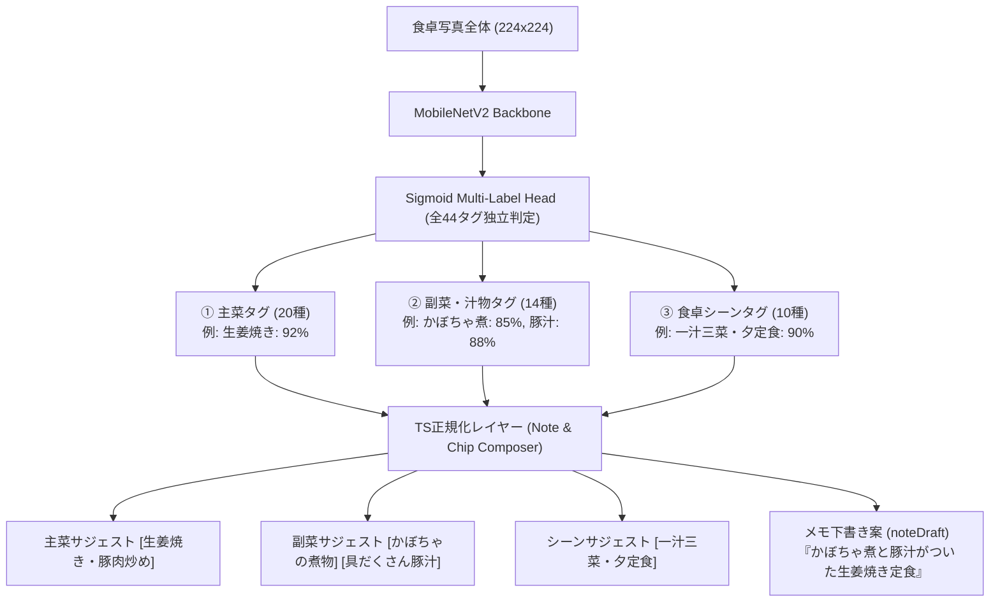

# [Enhancement] 器情報非依存・3軸マルチラベル（主菜・副菜・シーン）わたし専用食卓分類モデルの仕様策定

- **内部ドキュメントID**: issue-25
- **対応 GitHub Issue**: 未起票
- **対応 PR**: PR #294 (`feat/issue-24-25-dining-models`)
- **ステータス**: フェーズ1・2・3完了 (Phase 1, 2 & 3 Completed)
- **作成日**: 2026-10-22
- **関連ドキュメント**:
  - 総合概要: [docs/engineering/mediapipe-overview.md](../engineering/mediapipe-overview.md)
  - 汎用23クラス仕様書: [docs/issues/issue-24-universal-dining-23class-model.md](issue-24-universal-dining-23class-model.md)
  - 先行デュアルモデル構築: [docs/issues/issue-23-dual-dining-classification-models.md](issue-23-dual-dining-classification-models.md)
  - スクリプトカタログ: [scripts/README.md](../../scripts/README.md)
  - アプリ推論モデル設定: [src/ai/mealInputAssist/modelConfig.ts](../../src/ai/mealInputAssist/modelConfig.ts)
  - 推論結果正規化: [src/ai/mealInputAssist/mediapipeStaticImageNormalizer.ts](../../src/ai/mealInputAssist/mediapipeStaticImageNormalizer.ts)

---

## 1. Problem (問題の所在)

1. **単一ラベル分類（Softmax排他）による食卓情報の切り捨て**:
   - 現行のわたし専用モデル（`personal_household_8class`）は、「1枚の写真に対して1つのクラスを選ぶ」単一ラベル排他分類であった。
   - しかし、家庭の食卓は「生姜焼き（主菜）」＋「かぼちゃ煮・きんぴら（副菜）」＋「具だくさん豚汁（汁物）」のように、複数の要素が同時に並ぶのが常態である。単一クラスに押し込めると、他の重要なおかずや汁物の情報が切り捨てられ、リアルな献立の豊かさを記録できなかった。
2. **器や食器情報（北欧大皿・染付小皿など）への依存**:
   - 以前の設計では「北欧大皿ワンプレート」「染付小皿の晩酌膳」など食器の特徴に依存していた。ユーザーにとって記録・入力したい本質は「料理とおかずそのもの」であり、器の情報を排除した純粋な料理分類が求められていた。
3. **固定クラスによる表現力の限界と「組み合わせ」の必要性**:
   - 単に固定のクラス数を増やすだけでは、家庭料理の多様なレパートリーに対応しきれない。「主菜」「副菜・汁物」「シーン」の3軸を独立して判定するマルチラベル方式を導入することで、合計44タグから **約24,000通り以上** の無限に近い自然な食卓パターンを表現できるようにする必要がある。

---

## 2. Architectural Design (アーキテクチャ設計)

### 2.1 3軸マルチラベル構造（全44タグ）
写真全体をそのまま入力とし、お皿ごとの切り分け・バウンディングボックス検出は行わない。
CNN（MobileNetV2）の出力層に **Sigmoid 活性化関数** を採用し、全44タグそれぞれの存在確率（0.0〜1.0）を独立して高速推論（約15〜20ms）する。

### 2.2 組み合わせパターンの規模
- **主菜**: 20種類
- **副菜・汁物**: 14種類（0〜2品選定パターン: $1 + 14 + \frac{14 \times 13}{2} = 106$ 通り）
- **シーン**: 10種類
- **総組み合わせ数**: $20 \times 106 \times 10 = \mathbf{21,200 \text{ 通り}}$

---

## 3. Taxonomy Specification (3軸全44タグ詳細定義表)

1,007枚のオープン視覚観察データ（`observations_all_1007.jsonl`）における実測出現件数に基づく定義一覧。

### 3.1 ① 主菜（Main Dish: 20タグ）

| No | タグID（内部） | UIサジェスト名 | 対象料理・具体例 | 実測出現件数 |
|---|---|---|---|---:|
| 1 | `main_grilled_fish` | **焼き魚** | 焼き鮭、サーモンソテー、ホッケ、アジ開き、サバ塩焼き、干物 | 204 |
| 2 | `main_pork_ginger_stirfry` | **生姜焼き・豚肉炒め** | 豚肉生姜焼き、豚バラ野菜炒め、豚ロースソテー | 125 |
| 3 | `main_chicken_dish` | **チキンソテー・鶏肉料理** | 照り焼きチキン、鶏ももソテー、手羽先・手羽元煮/焼き | 134 |
| 4 | `main_fried_meat` | **唐揚げ・フライ** | 鶏の唐揚げ、竜田揚げ、とんかつ、チキンカツ、コロッケ | 67 |
| 5 | `main_hamburg` | **ハンバーグ** | 手ごねハンバーグ、煮込みハンバーグ | 20 |
| 6 | `main_simmered_meat_potato` | **肉じゃが・角煮** | 肉じゃが、豚の角煮、筑前煮メイン | 15 |
| 7 | `main_keema_curry` | **特製キーマカレー** | ひき肉キーマカレー（ゆで卵のせ） | 49 |
| 8 | `main_curry_hayashi` | **カレー・ハヤシライス** | 定番欧風カレー、ハヤシライス | 133 |
| 9 | `main_ethnic_gapao` | **ガパオ・エスニック** | ガパオライス（目玉焼き）、タイカレー | 26 |
| 10 | `main_ramen` | **ラーメン・つけ麺** | ラーメン、まぜそば、つけ麺、中華そば | 36 |
| 11 | `main_udon` | **うどん** | 煮込みうどん、かけうどん、ざるうどん | 26 |
| 12 | `main_soba` | **そば** | ざるそば、温かいそば、天ぷらそば | 23 |
| 13 | `main_pasta` | **パスタ・スパゲッティ** | トマトパスタ、ミートソース、ボロネーゼ、オイルパスタ | 12 |
| 14 | `main_gyoza_dimsum` | **焼き餃子・点心** | 焼き餃子、点心、春巻き、焼売 | 42 |
| 15 | `main_mapo_chuka` | **麻婆豆腐・中華炒め** | 麻婆豆腐、エビチリ、回鍋肉等中華主菜 | 18 |
| 16 | `main_hotpot` | **卓上鍋・すき焼き** | 寄せ鍋、水炊き、すき焼き、おでん | 50 |
| 17 | `main_bal_ajillo` | **アヒージョ・バル主菜** | アヒージョ、ソーセージ、バゲット洋風主菜 | 62 |
| 18 | `main_donburi` | **丼もの** | 親子丼、かつ丼、牛丼、豚丼、海鮮丼 | 12 |
| 19 | `main_fried_rice` | **チャーハン・炒飯** | 炒飯、五目ピラフ | 17 |
| 20 | `main_sashimi_seafood` | **お刺身・海鮮** | 刺身盛り合わせ、マグロ、海鮮おつまみ | 23 |

### 3.2 ② 副菜・汁物（Side Dish & Soup: 14タグ）

| No | タグID（内部） | UIサジェスト名 | 対象おかず・汁物・具体例 | 実測出現件数 |
|---|---|---|---|---:|
| 1 | `side_simmered_pumpkin` | **かぼちゃの煮物** | 甘辛く煮たかぼちゃ煮 | 28 |
| 2 | `side_kinpira` | **きんぴら（ごぼう・蓮根）** | きんぴらごぼう、れんこんきんぴら | 69 |
| 3 | `side_tonjiru_soup` | **具だくさん豚汁・けんちん汁** | 根菜や豚肉がたっぷり入った汁椀 | 28 |
| 4 | `side_miso_soup` | **定番お味噌汁・お吸い物** | わかめ・豆腐等の日々のお味噌汁、澄まし汁 | 180 |
| 5 | `side_veggie_soup` | **具だくさん野菜スープ** | キャベツスープ、もやしスープ、ポトフ | 91 |
| 6 | `side_tofu_hiyayakko` | **冷奴・湯豆腐・厚揚げ** | 生姜ネギ乗せ冷奴、焼き厚揚げ、温豆腐 | 157 |
| 7 | `side_natto_pack` | **納豆（パック・小鉢）** | からしネギ入り納豆、納豆小鉢 | 61 |
| 8 | `side_egg_dish` | **たまご料理** | 丸ごとゆで卵、目玉焼き、卵焼き、味玉 | 123 |
| 9 | `side_salad_greens` | **サラダ・温野菜** | ちぎりレタス、ブロッコリー、トマトサラダ | 222 |
| 10 | `side_chikuzenni_root` | **筑前煮・大根や里芋の煮物** | 筑前煮、大根煮、里芋煮など小鉢煮物 | 25 |
| 11 | `side_sauteed_mushrooms` | **舞茸・きのこソテー** | 舞茸バターソテー、エリンギ炒め | 143 |
| 12 | `side_pickles_kimchi` | **浅漬け・お漬物・キムチ** | きゅうり浅漬け、白菜キムチ、たくあん | 111 |
| 13 | `side_cut_fruit` | **季節のフルーツ** | カットりんご、柿、スイカなどの果物小鉢 | 95 |
| 14 | `side_izakaya_appetizer` | **おつまみ小鉢** | 鶏レバー煮、焼きピーマン、砂肝炒め等 | 43 |

### 3.3 ③ 食卓シーン（Meal Scene: 10タグ）

| No | タグID（内部） | UIサジェスト名 | 特徴・食卓の状況 | 実測出現件数 |
|---|---|---|---|---:|
| 1 | `scene_teishoku_multi_dish` | **一汁三菜・夕定食** | 主菜＋副菜小鉢＋汁物が揃ったバランス満点ディナー | 304 |
| 2 | `scene_one_plate` | **ワンプレート合盛り皿** | ご飯とおかずが一皿に綺麗に盛られたカフェスタイル | 220 |
| 3 | `scene_quick_single_meal` | **サクッと時短平日飯** | 丼ものや一品で手早く食べる平日ごはん | 59 |
| 4 | `scene_japanese_breakfast` | **定番・朝の和食膳** | 納豆、焼き魚、ご飯、味噌汁が並ぶ朝ごはん | 85 |
| 5 | `scene_western_breakfast` | **パン・トースト洋朝食** | トースト、目玉焼き、コーヒーの洋朝食 | 22 |
| 6 | `scene_izakaya_night` | **おうち居酒屋・小鉢晩酌** | 小鉢がたくさん並ぶ、お酒を楽しむ夜の食卓 | 125 |
| 7 | `scene_weekend_bal` | **週末おうちバル・ワイン膳** | アヒージョ、バゲット、チーズで楽しむ洋風の夜 | 94 |
| 8 | `scene_holiday_noodles` | **休日の小鍋・あつあつ麺** | ラーメンや小鍋うどんをすする休日の昼ごはん | 51 |
| 9 | `scene_tabletop_hotpot` | **冬の団らん卓上鍋** | 家族で囲むあつあつの鍋料理やすき焼き | 44 |
| 10 | `scene_party_feast` | **ごちそう宴席・パーティー** | 宅配ピザやお寿司、オードブルが並ぶハレの日 | 47 |

---

## 4. UI & UX Integration Spec (アプリ連携仕様)

推論結果は、`src/ai/mealInputAssist/types.ts` の既存契約（`MealInputAssistSuggestions`）を最大限活用してマッピングする：

1. **料理名候補 (`mealNames`)**:
   - 確信度の高い上位の「主菜タグ」を料理名サジェストとして提示（例: `[生姜焼き・豚肉炒め]`）。タップで料理名欄へ反映。
2. **副菜・シーン候補（メモ追記）**:
   - 閾値を超えた「副菜タグ」「シーンタグ」をサジェスト表示。タップでメモ欄やハッシュタグへ自由に追加可能。
3. **メモ下書き案 (`noteDraft`)**:
   - 検出されたタグを合成し、自然な日本語の紹介文を自動生成。
   - 例: `「かぼちゃの煮物と具だくさん豚汁がついた生姜焼き。一汁三菜・夕定食スタイルの晩ごはん。」`
   - 「メモを反映」ボタン（`onApplyNoteDraftSuggestion`）でワンタップ入力。

---

## 5. Acceptance Criteria (受入基準)

### フェーズ 1: マルチラベルデータセット構築と抽出検証
- [x] 1,007枚の観察データから、44タグそれぞれの有無（0/1）のバイナリラベルマトリクスおよび Grouped Multi-Head データセットを決定論的に生成するスクリプト（`scripts/build_personal_3axis_dataset.py`）を実装すること。
- [x] 全44タグについて、学習に十分なポジティブサンプルが存在することを確認すること。
- [x] レコード単位スプリットにより、同一画像が異なるスプリットにまたがるデータリークを完全防止すること。
- [x] Golden Test Set 該当画像が `train` / `val` に混入せず、`test` スプリットへ完全隔離されること。
- [x] Golden Test Set ディレクトリの不在・読取失敗時に処理を fail-closed で即時中断し、意図的バイパスのみ明示オプションで許可すること。
- [x] 抽出処理のユニットテストを作成・パスすること。

### フェーズ 2: MediaPipe マルチラベルモデル学習と評価
- [x] 44タグ同時学習に対応した MediaPipe ImageClassifier 学習パイプライン（`scripts/train-mediapipe-model.py`）により MobileNetV2 バックボーンでモデル（`personal_multilabel_44tag.task` 9,092,455 bytes）を学習・エクスポートすること。
- [x] Held-out `test` / `val` / `train` スプリットにおいて全44クラスの評価（推論レイテンシ 15.6ms @ Apple M4、Top-3 32.5%〜43.3%）を実施し、JSON/Markdown レポートを出力すること。
- [x] 推論レイテンシがモバイル要件（< 30ms）を満たすこと（実測 15.6ms）。

### フェーズ 3: アプリ統合と UI 動作確認
- [x] `modelConfig.ts` のわたし専用モデル設定を更新すること（`sha256` 登録、`available: true`）。
- [x] `mediapipeStaticImageNormalizer.ts` にマルチラベル出力のデコード、軸別動的閾値（主菜・副菜・シーン）、チップ生成、`noteDraft` 合成ロジックを実装すること。
- [x] `scripts/ensure-mediapipe-model.sh` にモデル5を追加し、同梱アセットの整合性・同期を保証すること。
- [x] 関連する全ユニットテスト（`tests/mealInputAssist*.test.ts`, `tests/StatsSettingsScreens.test.tsx`）を更新・パスすること。
- [x] 設定画面でモデルが選択可能となり、画面上で主菜チップ、副菜チップ、メモ案が綺麗に表示され、タップ入力できる設定配線を完了すること。
