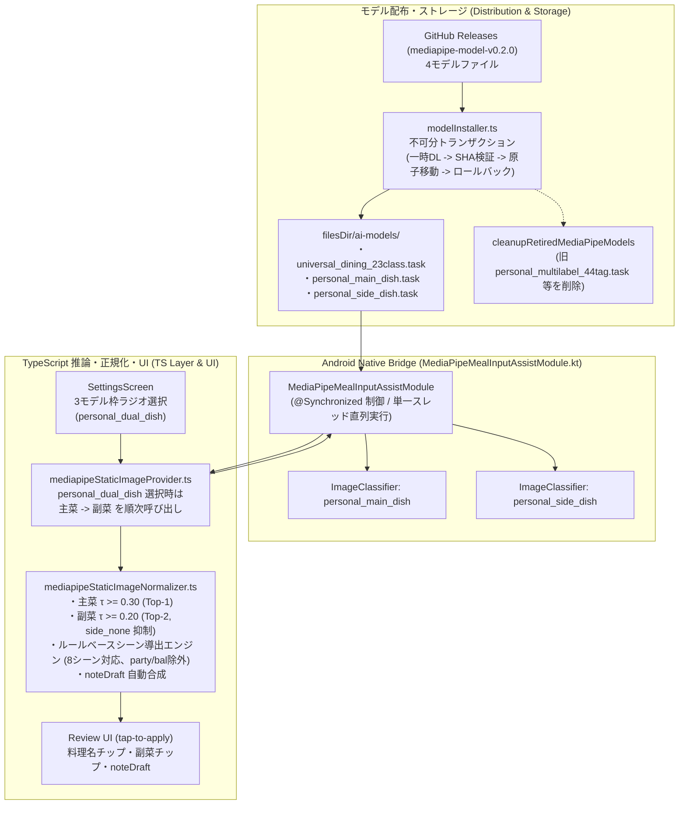

# [Enhancement] 食事分類刷新 Step 3: 主菜・副菜2モデル分離統合、汎用Lite2更新、シーン導出ルール、noteDraft合成

- **内部ドキュメントID**: issue-27
- **対応 GitHub Issue**: 未起票
- **対応 PR**: PR #307 (PR 1), PR #308 (PR 2, `feat/mediapipe-refresh-step3-app-integration`)
- **ステータス**: 完了 (Completed)
- **作成日**: 2026-10-31
- **関連ドキュメント**:
  - 総合概要: [docs/engineering/mediapipe-overview.md](../engineering/mediapipe-overview.md)
  - 先行3軸マルチラベル仕様: [docs/issues/issue-25-personal-multilabel-3axis-model.md](issue-25-personal-multilabel-3axis-model.md)
  - 先行汎用23クラス仕様: [docs/issues/issue-24-universal-dining-23class-model.md](issue-24-universal-dining-23class-model.md)
  - デュアルモデル基礎設計: [docs/issues/issue-23-dual-dining-classification-models.md](issue-23-dual-dining-classification-models.md)
  - アプリ推論モデル設定: [src/ai/mealInputAssist/modelConfig.ts](../../src/ai/mealInputAssist/modelConfig.ts)
  - アプリ推論モデルインストーラー: [src/ai/mealInputAssist/modelInstaller.ts](../../src/ai/mealInputAssist/modelInstaller.ts)
  - 推論結果正規化・シーン導出: [src/ai/mealInputAssist/mediapipeStaticImageNormalizer.ts](../../src/ai/mealInputAssist/mediapipeStaticImageNormalizer.ts)
  - 静的画像推論プロバイダ: [src/ai/mealInputAssist/mediapipeStaticImageProvider.ts](../../src/ai/mealInputAssist/mediapipeStaticImageProvider.ts)

---

## 1. Problem (問題の所在)

1. **旧44タグ単一マルチラベルモデルの精度限界**:
   - `personal_multilabel_44tag.task` は、主菜（20種）・副菜（14種）・食卓シーン（10種）を1つのモデルで同時に Sigmoid 推論する設計であったが、人手ラベル評価セットでの実測 Top-1 精度は 18.2% にとどまり、実用的な提案精度を満たしていなかった。
2. **Step 2 分離学習モデルの統合要件**:
   - 食事分類刷新の Step 2 において、主菜モデル（Lite0、16クラス）と副菜モデル（Lite2、14クラス＋`side_none`）を個別に学習・評価した結果、主菜 Lite0 は Top-1 57.9% / Top-3 79.4%、副菜 Lite2 は Top-1 48.7% と大幅な精度向上が実証された。また汎用23クラスモデルも Lite2（Top-1 46.4%、Step 2 で学習した Lite0 比 +9.8pt）への刷新が決定した。
   - これらをアプリに組み込むには、従来の「1モデルID = 1ファイル」前提の配布・管理・推論パイプラインを、ペア（主菜・副菜の2ファイル）に対応した構成へ刷新する必要があった。
3. **片肺（一方のみダウンロード完了）状態の防止と旧アセットの安全移行**:
   - 2ファイル構成となることで、主菜のみダウンロード成功して副菜が失敗したような不完全な「片肺」状態で推論が走りクラッシュ・誤動作するリスクを構造的に排除する必要があった。
   - また、旧 `personal_multilabel_44tag` を選択していた既存端末の設定マイグレーション、旧ステータスキーの掃除、および端末内内部ストレージ（`filesDir/ai-models/`）に残る約9MBの旧 `.task` ファイルの回収・削除が必要であった。
4. **食卓シーン判定とメモ下書き（noteDraft）の導出**:
   - 食卓シーン（定食、晩酌膳、麺類単品など）は画像特徴からの学習を行わず、推論された主菜・副菜の組み合わせや記録時刻からルールベースで決定論的に導出し、`noteDraft`（食事メモ下書き案）を自動合成する設計が求められた。

---

## 2. Architecture & Design (アーキテクチャ設計)

本改修は、基盤整備（PR 1 / #307）とアプリ統合（PR 2）の2段階に分割して安全に実装された。

### 2.1 不可分ペアダウンロード・片肺防止トランザクション (modelInstaller.ts)
`personal_dual_dish` のインストールでは、主菜（`personal_main_dish.task`）と副菜（`personal_side_dish.task`）の双方を一時ディレクトリにダウンロードし、それぞれの SHA-256 チェックサムを検証した上で、2ファイル単位の不可分トランザクションとして配置する。既存ファイルが存在する場合は両方をバックアップへ退避し、新ファイルの配置および `ready` 状態の永続化が完全に成功するまでバックアップを保持する。途中でエラーが発生した場合は新規配置ファイルを削除して旧ファイルを両方復元し、既存の正常なペアを破壊しない設計としている。
また、端末内のファイル状態を確認する `getMediaPipeModelStatusForModel` において、主菜・副菜の片方のみが存在する「片肺」状態を検知した場合は、未インストール扱いとせず残存ファイルを即座に掃除した上で、再ダウンロードを促すエラー状態（`kind: 'error'`）を返す。

### 2.2 Android Native Bridge 2インスタンス保持 (PR 1 / #307)
`MediaPipeMealInputAssistModule.kt` において、`personal_dual_dish` で使用される `personal_main_dish` と `personal_side_dish` の2つの `ImageClassifier` インスタンスを同時に保持し、TS レイヤーからの順次推論要求に高速に応答する。モデル切り替えや解放時には `@Synchronized` により排他制御を行い、リソースリークや競合状態を防止する。

### 2.3 閾値較正と提案抑制 (mediapipeStaticImageNormalizer.ts)
- **主菜**: 信頼度閾値 $\tau \ge 0.30$（較正データにおいて 0.35 で精度 80%、0.30 を下限採用）。Top-1 のみを採用。
- **副菜**: 信頼度閾値 $\tau \ge 0.20$。Top-2 のチップ提示。
- **`side_none` 抑制**: 副菜モデルの `side_none` クラスは `excludeFromSuggestions: true` とし、UI サジェストチップおよび `noteDraft` から完全に除外。
- **低信頼度フォールバック**: 主菜・副菜ともに閾値未満の場合は、無理な提案を行わず `suggestions` は空配列、`noteDraft` は `null` としてフォールバック。

### 2.4 ルールベース食卓シーン判定 (deriveSceneFromDishes)
モデル学習から除外されたシーン分類を、主菜・副菜の組み合わせと時刻（朝・昼・夜）から決定論的に導出するルールエンジンを実装。以下の 8 シーンに対応付け、一致しない場合は `null` を返す：
- `scene_tabletop_hotpot`（冬の団らん卓上鍋）: 主菜または副菜に鍋料理を含む場合。
- `scene_holiday_noodles`（休日のあつあつ麺）: 主菜がラーメン・中華麺、うどん・そば、和風麺類の場合。
- `scene_izakaya_night`（おうち居酒屋・晩酌）: おつまみ小鉢・刺身、または夜帯（18時以降または早朝4時前）の冷奴等の晩酌膳の場合。
- `scene_japanese_breakfast`（定番の和朝食）: 納豆、または朝帯（4〜11時）の焼き魚・たまご料理の場合。
- `scene_western_breakfast`（パンの洋朝食）: 朝帯（4〜11時）かつ主菜なしでサラダ・カットフルーツ・たまご料理等の洋風副菜の場合。
- `scene_one_plate`（ワンプレート）: カレー、ハヤシ、キーマ、ガパオ、炒飯、丼もの等のワンプレート料理の場合。
- `scene_teishoku_multi_dish`（一汁三菜・夕定食）: 主菜があり、汁物（味噌汁/豚汁/スープ）＋汁物以外の小鉢が1品以上揃っている場合。
- `scene_quick_single_meal`（サクッと平日飯）: 主菜のみ（定食などの副菜条件に合わない・副菜なし等）の場合。

※なお、`scene_party_feast`（ごちそう宴席パーティー）および `scene_weekend_bal`（週末おうちバル）の2シーンは、料理・副菜・時刻情報だけでは決定論的に判定できないため、自動ルール導出の対象外としている。

---

## 3. Model Specifications (モデル仕様とハッシュ値)

GitHub Releases タグ: `mediapipe-model-v0.2.0`

| モデル枠ID | 実体ファイル名 | アーキテクチャ | クラス数 | ファイルサイズ | SHA-256 チェックサム |
|---|---|---|---|---|---|
| `cooking_method_9class` (標準) | `meal-input-assist.task` | MobileNetV2 | 9クラス | 8,984,478 bytes | `3aa1ca0ea2e88a3b83641fbcf73c66f50b4be0c41fc8dfdd0684f04c60a28b0d` |
| `universal_dining_23class` (汎用) | `universal_dining_23class.task` | Lite2 | 23クラス | 5,296,878 bytes | `37fb1f5a53be4c5e396603a1188338e3e4a9e5256e2e505ea96c1421ebefd1aa` |
| `personal_dual_dish` (主菜) | `personal_main_dish.task` | Lite0 | 16クラス | 3,722,865 bytes | `2559d4cf6741aa29ce975dcf74268e6fcb275bf978b7bdfa5a40b938091ff80e` |
| `personal_dual_dish` (副菜) | `personal_side_dish.task` | Lite2 | 15クラス | 5,285,463 bytes | `703b454865e9052b04753086ebc02058e579233e7264850fa97843818e95df57` |

---

## 4. Verification & Quality Assurance (検証と品質保証)

1. **ユニットテスト網羅性**:
   - `tests/mealInputAssistModelInstaller.test.ts`: ペアの同時ダウンロード、SHA-256 破損時のロールバック、2ファイル単位のトランザクション復元、片肺状態の自動掃除とエラー返却、一括削除、退役モデルファイル回収（29件 PASS）。
   - `tests/mealInputAssistNormalizer.test.ts`: 新閾値較正（主菜 $\ge 0.30$、副菜 $\ge 0.20$）、`side_none` 抑制、8食卓シーン判定ルール（サクッと平日飯の補完含む）、決定論的固定タイムスタンプ、noteDraft 合成、低信頼度フォールバック（16件 PASS）。
   - `tests/AppSettingsService.test.ts`: `personal_dual_dish` の保存と取得、旧モデル（`personal_multilabel_44tag`, `personal_household_8class`）からの自動移行、旧ステータスキーの削除（15件 PASS）。
   - `tests/StatsSettingsScreens.test.tsx`: 設定画面での 3 選択肢レンダリング、モデル切替・保存・ステータス再取得（35件 PASS）。
2. **型検査**:
   - `npm run type-check`: エラー 0 件。
3. **CI / PR Gate**:
   - `scripts/verify-pr-gates.sh`: 必須4セクションおよび設計条件チェックリストの機械的検証を通過。
