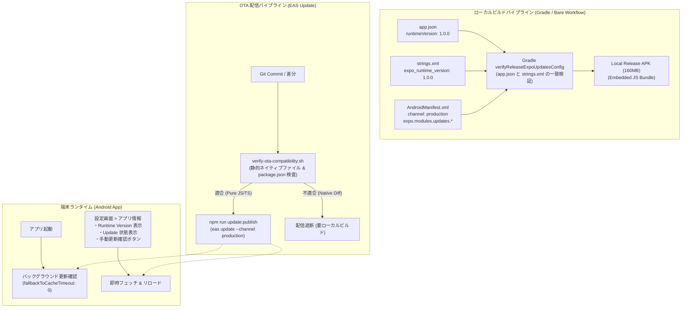

# [Feature] EAS Update (expo-updates) 導入: JSのみ修正のOTA緊急配信パイプラインと互換性保護

- **内部ドキュメントID**: issue-28
- **対応 GitHub Issue**: GitHub Issue #52
- **対応 PR**: `feat/eas-update-integration`
- **ステータス**: 実装・検証完了 (Ready for Review)
- **作成日**: 2026-11-03
- **関連ドキュメント**:
  - EAS Update 運用ガイドライン: [docs/engineering/eas-update-guidelines.md](../engineering/eas-update-guidelines.md)
  - ビルド情報ユーティリティ: [src/utils/buildInfo.ts](../../src/utils/buildInfo.ts)
  - 設定画面: [src/screens/SettingsScreen/SettingsScreen.tsx](../../src/screens/SettingsScreen/SettingsScreen.tsx)
  - OTA 互換性ゲート: [scripts/verify-ota-compatibility.sh](../../scripts/verify-ota-compatibility.sh)
  - Android リリースビルドスクリプト: [scripts/build-android-release.sh](../../scripts/build-android-release.sh)
  - 依存管理ポリシー: [docs/engineering/dependency-policy.md](../engineering/dependency-policy.md)

---

## 1. Problem (問題の所在)

1. **JS/TS 修正配信における過大なビルド・配布コスト**:
   - 本アプリは Bare Workflow で運用されており、MediaPipe モデル（4ファイル・計約35MB）を含むリリース APK のサイズは約 160MB に達する。
   - タイポ修正、UI 微調整、JS のみの不具合修正であっても、毎回ローカルで ProGuard 難読化を伴う Release APK を再ビルドし、USB 経由（`adb`）で端末へ再インストールする必要があり、緊急修正の即時反映が困難であった。
2. **無料枠運用の制約と EAS Build 排除**:
   - 外部クラウド課金やクレジットカード登録を行わず、EAS Update の Free Plan（月間 1,000 MAU 枠）の範囲内で完結させる必要があった。
   - クラウドビルド（EAS Build）は採用せず、既存のローカルビルド体制（`npm run release:android` / Gradle）を堅持する必要があった。
3. **ネイティブ不整合によるクラッシュリスクの防止**:
   - Bare Workflow 環境では、ネイティブコードやネイティブライブラリの更新を伴う JS コードが OTA で配信されると、端末のネイティブ側と不整合を起こして即座にクラッシュする致命的リスクがある。
   - OTA 配信してよい範囲（JS/TS、スタイル、文言、純粋 JS 依存）と、ローカル APK 再ビルドが必要な範囲の境界を厳格に機械的ゲートで保護する仕組みが不可欠であった。

---

## 2. Architecture & Design (アーキテクチャ設計)

本改修では、「ローカルビルドの堅持」「物理的ゲートによる互換性保護」「完全無料枠内での運用」を両立するアーキテクチャを設計した。

### 設計の要点
1. **Bare Workflow におけるチャンネル解決**:
   - EAS Build を使わないローカル Gradle ビルドではビルド時に動的チャンネル注入が行われないため、`android/app/src/main/AndroidManifest.xml` の meta-data `expo.modules.updates.UPDATES_CONFIGURATION_REQUEST_HEADERS_KEY` に `{"expo-channel-name":"production"}` を明示指定。
2. **2重の整合性検証ゲート**:
   - ビルド時: `android/app/build.gradle` の `verifyReleaseExpoUpdatesConfig` タスクおよび `scripts/build-android-release.sh` により、`app.json` と `strings.xml` の `runtimeVersion` 一致を検証。
   - 配信時: `scripts/verify-ota-compatibility.sh`（`npm run update:check`）により、差分内の `android/`、`package-lock.json`、Tier 1 ネイティブパッケージ混入を物理的にブロック。
3. **ユーザー体験への配慮**:
   - `fallbackToCacheTimeout: 0` により、起動時のネットワーク待機によるブラックスクリーンを回避。
   - 設定画面の「アプリ情報」セクションに `Runtime Version`、`Update`（Embedded または OTA ID）、および手動更新確認ボタンを追加。

---

## 3. Implementation Details (実装詳細)

### 変更ファイル一覧
- **依存関係**:
  - `package.json`, `package-lock.json`: `"expo-updates": "~58.0.20"` 追加、スクリプト `"update:check"`, `"update:publish"` 追加。
- **設定ファイル**:
  - `app.json`: `runtimeVersion: "1.0.0"`, `updates` 設定追加。
  - `eas.json`: `development`, `preview`, `production` 各プロファイルに `channel` 定義。
  - `android/app/src/main/res/values/strings.xml`: `expo_runtime_version` 追加。
  - `android/app/src/main/AndroidManifest.xml`: `expo.modules.updates.*` meta-data 追加。
  - `android/app/proguard-rules.pro`: `-keep class expo.modules.updates.** { *; }` 追加。
  - `android/app/build.gradle`: `verifyReleaseExpoUpdatesConfig` タスク追加。
- **検証スクリプト**:
  - `scripts/build-android-release.sh`: `runtimeVersion` 一致検証ロジック追加。
  - `scripts/verify-ota-compatibility.sh`: OTA 適合性判定スクリプト新規作成。
- **UI & ヘルパー**:
  - `src/utils/buildInfo.ts`: `getRuntimeVersion`, `getUpdateChannel`, `getUpdateSummary`, `isUpdatesEnabled`, `checkAndApplyOtaUpdate` 追加。
  - `src/screens/SettingsScreen/SettingsScreen.tsx`: アプリ情報セクションへの行追加および手動更新ボタン追加。
- **テスト**:
  - `jest.setup.js`: `expo-updates` モック定義改修。
  - `tests/buildInfo.test.ts`: EAS Update ヘルパーテスト（35件 PASS）。
  - `tests/StatsSettingsScreens.test.tsx`: 設定画面 EAS Update 表示・更新確認テスト（39件 PASS）。
  - `tests/buildAndroidRelease.test.ts`: Gradle タスクおよびリリーススクリプト同期テスト（21件 PASS）。
  - `tests/verifyOtaCompatibility.test.ts`: OTA 互換性ゲートのユニットテスト（8件 PASS）。
- **ドキュメント**:
  - `docs/engineering/eas-update-guidelines.md`: 運用 Runbook・線引き基準。
  - `docs/issues/issue-28-eas-update-introduction.md`: 本仕様書。

---

## 4. Verification & Testing (検証結果)

### 自動テスト結果
- `npm run type-check`: 型エラー 0 件 (PASS)
- `npx jest tests/buildInfo.test.ts`: 35 passed, 0 failed (PASS)
- `npx jest tests/StatsSettingsScreens.test.tsx`: 39 passed, 0 failed (PASS)
- `npx jest tests/buildAndroidRelease.test.ts`: 21 passed, 0 failed (PASS)
- `npx jest tests/verifyOtaCompatibility.test.ts`: 8 passed, 0 failed (PASS)

---

## 5. Rollout & Operations (運用方針)

- **日常の修正**:
  - JS/TS のみの修正は `npm run update:check` で安全性を確認の上、`npm run update:publish` で即座に配信。
- **ネイティブ修正時**:
  - ネイティブ変更を伴う場合は `app.json` および `strings.xml` の `runtimeVersion` を `1.0.1` 等にバンプし、`npm run release:android` でローカル APK をビルドしてインストールする。
